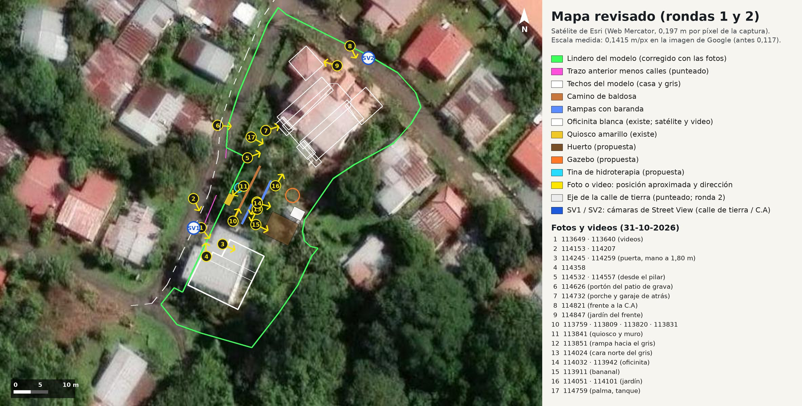
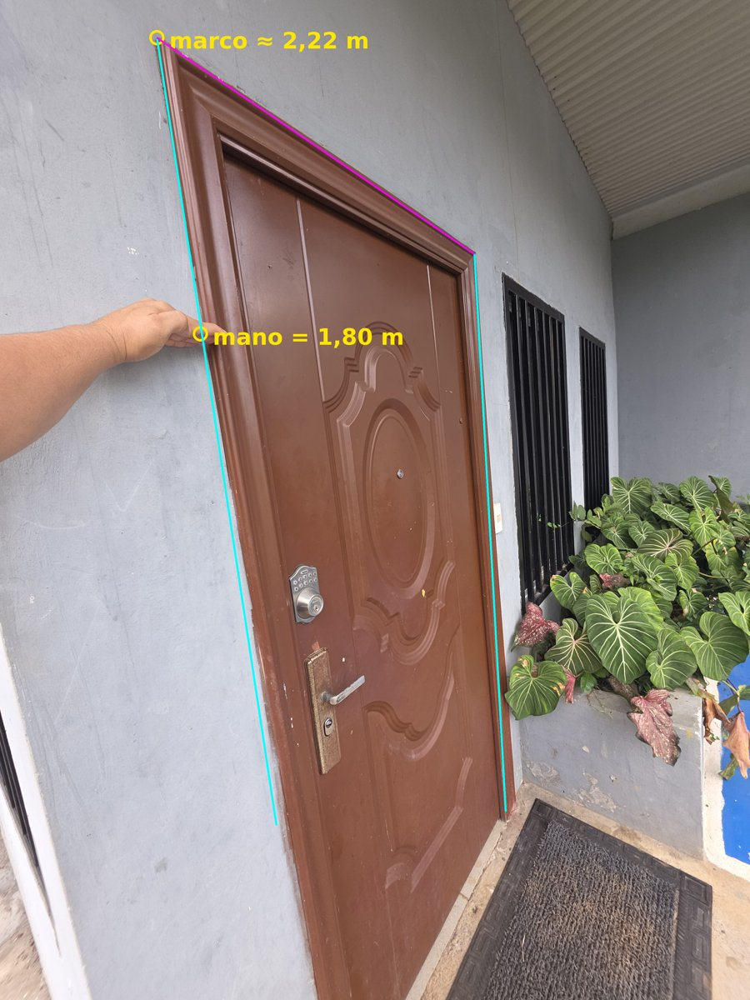
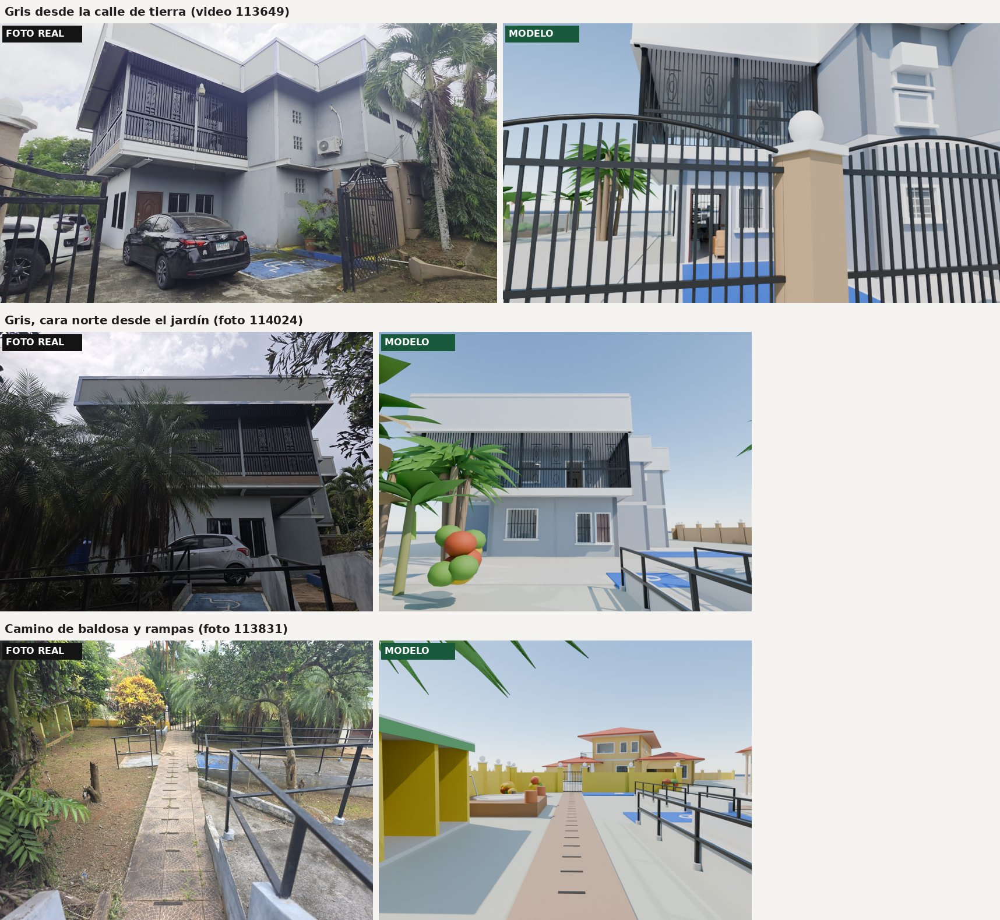
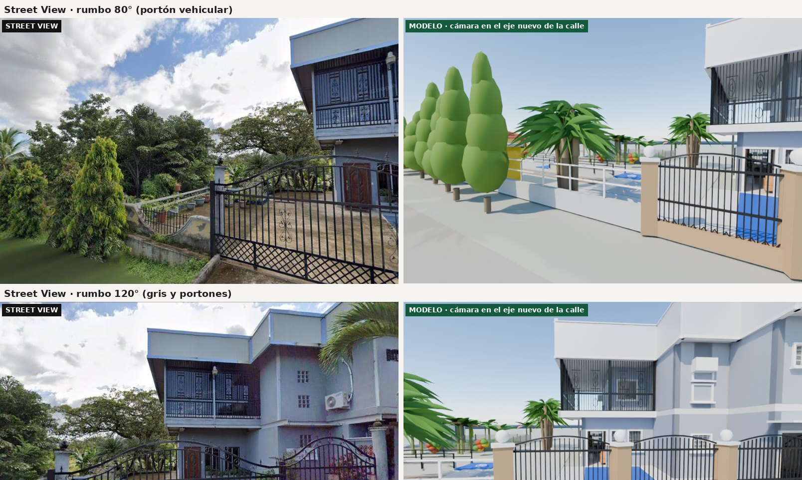

# Fase 1 · Mapa revisado con las fotos y videos del 31-10-2026

Ernesto fue al lugar el 31-10-2026 e hizo 20 fotos y 6 videos (copias reducidas en
`docs/fotos-referencia-2026-10-31/`). En una puso la mano a 1,80 m (su estatura) junto a la puerta del
edificio gris como referencia. Con eso y con tres satélites (Google, Esri y Bing) se revisó el mapa del
modelo. **Hallazgo principal: la escala estaba mal; todo el modelo era ~21 % más chico en planta.**



## 1. Escala del satélite (lo que más cambia)

Antes la escala salía de suponer que el trazo del lote (menos las calles) medía 2.500 m²: 0,117 m por
píxel de `docs/lote-satelite.png`. Ahora se midió de tres formas independientes:

| Fuente | Cómo | m por píxel de `lote-satelite.png` |
| --- | --- | --- |
| Barra de escala de Google Maps | misma imagen, mismo zoom: 5 m = 66 px css; la imagen del lote está a 0,951 de la captura | 0,144 |
| Esri World Imagery | zoom 19 en Web Mercator (0,295 m/px a 8,41° N); registro con la imagen de Google | 0,140 |
| Bing | mismo método; distancia entre los centros de la casa y del gris | 0,139 |

Se usa **0,1415 m/px** (`sitio.S_MEDIDA`). El factor sobre lo anterior es **KP = 1,211**
(`sitio.kp()`): las medidas de planta de `fachadas.py`, `interiores.py` y `amueblado.py` quedan como
"unidades de diseño" y el Empty de cada edificio las pasa a metros. Las alturas no cambian. Los muebles,
lámparas, aires y cuadros conservan su tamaño real.

| Medida | Antes | Ahora |
| --- | --- | --- |
| Techo del edificio gris | 14,4 × 13,5 m | 17,4 × 16,3 m (Bing mide ~17,6 m el lado largo) |
| Techo de la casa (sin cochera) | ~15 × 14 m | ~18 × 17 m |
| Sala de personas encamadas | ~35 m², pasillo central de ~1,0 m, mesa puente | ~51 m², pasillo central de ~2,1 m, mesita entre camas |
| Salón amarillo | ~20 m² | ~30 m² (con el baño nuevo adentro) |
| Trazo del lote menos calles | 2.500 m² (supuesto) | ~3.670 m²; con el lindero oeste y la calle de tierra corregidos, **~3.260 m²** |

**Lote:** con la escala medida el trazo no cabe en 2.500 m². Si la escritura dice 2.500 m², el lindero
real es más chico que el trazo (el este y el sur, que dan a vecinos, no se ven en las fotos).
Pendiente: pedir a la propietaria el plano catastral o la escritura con el polígono.

**Registro entre satélites:** Google, Esri y Bing no coinciden en posición absoluta (difieren 3–5 m por la
inclinación de cada toma); se registraron entre sí por puntos comunes (`docs/mapa/registro-satelites.json`).
Los techos del modelo (casa y gris) caen sobre los techos de Google y también sobre los de Esri, así que la
posición de los dos edificios queda confirmada. La calle de tierra, en cambio, pasa más al este de lo que se
había leído: su eje junto al gris se corrigió en la ronda 2 con Esri y con Street View (sección 7).

## 2. Altura con la mano a 1,80 m

En la foto `20261031_114259.jpg` se ven los dos montantes del marco y el dintel. Con el punto de fuga de
las verticales, la línea del horizonte de la cámara (ultra gran angular del Galaxy S25 Ultra, 13 mm
equivalentes) y la relación doble sobre el montante izquierdo (piso, mano y esquina del marco):

- esquina superior del marco: **≈ 2,22 m** (2,19–2,24 m al variar la focal ±15 %);
- hoja de la puerta: ~2,10 m, la medida estándar;
- consecuencia: las alturas del modelo (entrepiso del gris a 3,20 m, techo a 6,35 m, puertas de 2,10 m)
  cuadran con las fotos; no se cambiaron.



## 3. Qué se corrigió en el modelo

**Edificio gris** (`fachadas.py`, `interiores.py`)
- La galería con verjas del tramo norte es en **L**: da al norte (hacia la casa) y también a la calle de
  tierra. Verjas negras de piso a techo con adornos de aros (antes eran listones grises); canto de losa
  y cielo blancos. El depósito (ex-biblioteca) retrocede detrás de la galería oeste.
- Planta baja bajo la galería oeste: puerta de metal café y dos ventanas con rejas (video 113649). Al
  norte, dos ventanas altas junto a la esquina.
- Remates de lámina con tapa y canto blancos; muro gris azulado como en las fotos.
- Baño nuevo dentro del salón amarillo, en la esquina del lado de la biblioteca (pedido del 30-10). El
  servicio de la terraza queda solo con inodoro y lavamanos. Las 4 camas siguen cabiendo.

**Lindero y portones** (`sitio.py`, `bloqueo.py`)
- El muro de la calle de tierra pasa a ~1 m del tramo sur del gris (el pilar del portón peatonal toca la
  fachada, fotos 114153 y 114358) y el muro del jardín queda a ~4 m del camino de baldosa (foto 113831).
  El trazo anterior lo dejaba ~10 m más afuera.
- Bolsillo de estacionamiento entre el muro y los tramos norte y medio, con un puesto accesible azul
  (cabe un carro de frente, como en la foto 114153).
- Pilares color arena con bola blanca; portón vehicular de barrotes con arco y celosía; portón peatonal
  en arco (abierto, frente a la puerta de acceso); portón recto al patio de grava de la casa (114626).

**Exteriores** (`exteriores.py`, nuevo)
- Existe hoy: camino de baldosa de abanico con franjas antideslizantes; rampas de concreto con murete
  gris y baranda negra de tubo; descansos azules con el símbolo de accesibilidad; muro amarillo con
  portón entre el jardín y el patio de grava; oficinita blanca con puerta corrediza de vidrio y techo de
  lámina (el satélite la muestra al noreste del gris); quiosco amarillo de dos vanos; bananal; palmas
  fénix junto a la galería norte; crotos; tocón.
- Propuesta (contexto del proyecto, no existe hoy): tina de hidroterapia donde estaba el mango (el tocón
  al oeste del camino), gazebo de juegos con letrero en el jardín del noreste y huerto de 4 surcos con
  cerca al lado de la oficinita.

**Casa amarilla**: toldo rojo de lona en arco junto al porche en arco del patio (fotos
casa-amarilla-patio y 114557). **Gris**: alerito blanco sobre la puerta de acceso y jardinera pintada de
azul (114245).

**Web**: el modelo y la ruta de la portada (`web/src/data/cine.ts`, x/z × 1,21) se regeneraron; la parada
"Jardín" ahora mira desde arriba de la casa hacia las rampas, el gazebo, la tina y el huerto. En el
recorrido 3D las palmas y árboles del lote salen de las fotos (palmas de navidad del portón del gris,
hilera de la calle de tierra, naranjo y árboles del césped, pino del jardín del frente) y el resto se
completa al azar. La página de avances tiene las vistas nuevas de personas encamadas, salón amarillo,
baño nuevo y depósito, y los planos con áreas en metros reales. El módulo `bpy` de pip no trae Draco:
`export_web.py` ahora comprime con gltf-transform (Node).

## 4. Interpretaciones (confirmar con la propietaria)

1. **"Donde están los tallos" = el bananal** y la **"oficinita de abajo" = la casita blanca con puerta de
   vidrio** que está a su lado. Encaja con lo que dijo: huerto con cerca "desde la oficinita de abajo
   hasta la esquina y la parte de atrás de la escuela". Si es así, la oficina del huerto ya no va dentro
   del gris (el modelo todavía la tiene en la planta baja del gris; se mueve cuando se confirme).
2. **La tina va donde estaba el mango**: se tomó el tocón grande al oeste del camino (foto 113831).
3. **Desnivel:** las rampas indican que el jardín sube del gris hacia la casa (estimado ~1 m). El terreno
   del modelo sigue plano; las rampas se dibujaron como pasarelas con murete y baranda.



## 5. Lo que falta (siguiente vuelta)

- Árboles grandes del jardín (cítricos, mango, palmas de navidad junto al portón del gris) y la hilera de
  palmas de la calle de tierra en el modelo de la web.
- Casa amarilla con las fotos nuevas: farol y bloques de vidrio del lado del garaje (114732), toldo rojo y
  tanque negro del lado del patio (114557, 114759), muro crema con remate curvo hacia la C.A (114821).
- Terreno con desnivel (~1 m, ver sección 7) en Blender y en el visor web: ronda 3.
- Volver a renderizar las demás vistas interiores con la escala nueva (las de `/avances` que no se
  rehicieron todavía muestran los cuartos un 21 % más chicos). En la PC con la RTX 3080:
  `& $b -b -P blender\bloqueo.py -- --solo interiores --muestras 64 --ancho 1280` y copiar
  `build\bloqueo\int_*.png` como JPG a `web\public\avances\`.

## 6. Medidas para la próxima visita (cinta métrica, 20 minutos)

1. Largo de la fachada oeste del gris de esquina a esquina y ancho de la cara norte.
2. Distancia del muro de la C.A a la fachada de la casa (para confirmar el retiro del frente).
3. Ancho y largo de la sala de encamadas y del salón amarillo (por dentro).
4. Altura de piso a techo de la planta baja del gris (para confirmar los 3,20 m).
5. Diferencia de altura entre el pie de la rampa (junto al gris) y el portón del patio de grava.
6. Medidas de la oficinita blanca y del quiosco.
7. Distancia del camino de baldosa al muro amarillo de la calle de tierra.

## 7. Ronda 2 · Street View, calle de tierra y desnivel (01-11-2026)

Se usaron dos panorámicas de Street View (anteriores a las fotos de 2026): **SV1** en la calle de tierra,
frente al portón vehicular del gris, y **SV2** en la C.A, frente a la casa (marcadas en el mapa). De cada
una se sacaron vistas a rumbos conocidos (80°, 120° y 160° en SV1) y se renderizó el modelo desde la misma
cámara (altura ~2,5 m, mismo campo de visión).

**Calle de tierra.** Con la cámara de SV1 donde la ubicaba el trazo anterior, el gris salía más chico y
lejos que en Street View. Se probaron cámaras corridas hacia el gris hasta que la galería en L, la esquina
del gris y el portón quedaron del mismo tamaño y en el mismo lugar del cuadro: eso pasa con la cámara a
**~5,8 m de la fachada oeste** (antes 8,3 m). Como el carro de Street View circula por el centro de una
calle angosta, el eje se movió ~2,5 m hacia el gris junto al edificio (`sitio.OESTE`), con el mismo ancho.
Encaja con la foto 114153 (cabe un carro de frente entre el muro y el gris) y con el satélite de Esri, que
muestra la franja de tierra pegada al gris. El lindero junto al gris no cambia (lo fija el muro de las
fotos); el lote pasa de ~3.290 a **~3.260 m²**.



**Casa.** Los techos del modelo caen sobre los de Google y de Esri, y desde SV2 la fachada de la C.A se ve
del tamaño esperado: la casa no se mueve. (Una lectura anterior con Esri la ponía 5–7 m más cerca de la C.A;
era un error de registro entre imágenes, ya corregido.)

**Desnivel.** Desde SV1, al norte del portón vehicular el jardín queda **más alto que la calle**: muro de
contención de concreto de unos 0,6–0,8 m, encima un muro curvo crema con verja y la baranda de la rampa
detrás. Con las rampas del camino de baldosa (fotos 113759–113851) el jardín sube del gris hacia la casa
~1 m en total. En el modelo se dibujó el murete de 0,7 m con baranda en ese tramo del lindero; el terreno
sigue plano hasta tener la medida (pregunta 5 de la sección 6). Pasa a la ronda 3.

**Otros ajustes de la ronda 2:** frente al tramo sur del gris no hay muro (en Street View la fachada da
directo a la orilla con palmas), así que se quitó ese tramo; los pilares del frente de la casa llevan bola
color teja (Street View desde la C.A);
el mapa (`blender/mapa_fotos.py`) se arma ahora con los techos reales del modelo, el eje de la calle y las
dos cámaras de Street View.

## Archivos

| Archivo | Qué es |
| --- | --- |
| `docs/mapa/mapa-fase1.jpg` | Satélite de Esri con el lindero, los techos del modelo, los exteriores y dónde se tomó cada foto |
| `docs/mapa/comparacion-fotos-modelo.jpg` | Foto real contra modelo (gris desde la calle, cara norte, camino y rampas) |
| `docs/mapa/puerta-medida.jpg` | Medición del marco de la puerta con la mano a 1,80 m |
| `docs/mapa/modelo-cenital.jpg` | Vista cenital del modelo |
| `docs/mapa/comparacion-street-view.jpg` | Street View (SV1) contra el modelo desde la misma cámara |
| `docs/mapa/satelite-esri-z19.jpg`, `satelite-bing-z19.jpg`, `registro-satelites.json` | Satélites a escala conocida y su registro con la imagen de Google |
| `blender/mapa_fotos.py` | Arma `mapa-fase1.jpg` (techos leídos de `bloqueo.blend`) |
| `docs/fotos-referencia-2026-10-31/` | Fotos (1280 px) y cuadros de los videos |
| `blender/vista_rapida.py` | Render rápido desde cualquier cámara para comparar con una foto |

Regenerar (PowerShell en `realstate`, o `python3` con el módulo `bpy` en la nube):
```
& $b -b -P blender\bloqueo.py -- --solo ninguno
& $b -b -P blender\web_muestras.py
& $b -b -P blender\export_web.py
python blender\mapa_fotos.py      # con el módulo bpy
```
