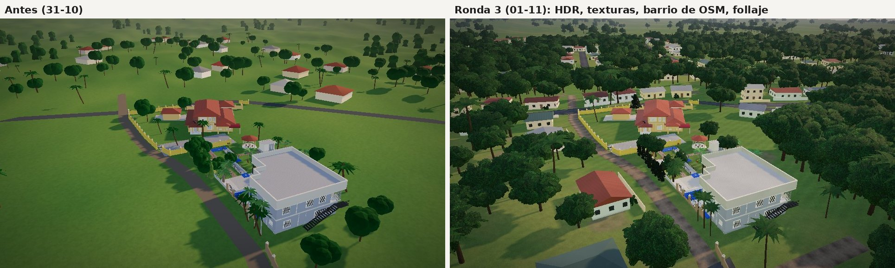

# Ronda 3 · Realismo en la web (01-11-2026)

Objetivo: que el recorrido 3D y la portada dejen de verse "de videojuego". Lo que más lo delataba era el
entorno: césped de un solo color, casas vecinas de caja con techo de pirámide puestas al azar, árboles de
bolas facetadas, calles que eran rectas prolongadas y cerros grises a 1 km. Los edificios eran de colores
planos.



## Qué cambió

**Luz y color** (`web/src/visor/visor.ts`)
- Luz ambiente de una foto HDR real (Rooitou Park de Poly Haven, CC0, tomada del repositorio
  `pmndrs/drei-assets`), reducida a 512 × 256 y sin el sol: el sol lo pone la luz direccional con sus
  sombras. Archivo: `web/public/tex/entorno_parque.hdr` (340 KB).
- Mapeo de tono ACES con exposición 0,76 (se probaron AgX y Neutral: AgX lavaba el césped y Neutral
  saturaba de más). Para comparar: `?tono=agx` o `?tono=neutral` en la URL.
- Vidrios más reflejantes (reflejan el cielo en vez de verse como huecos).

**Materiales del modelo** (`web/src/visor/realismo.ts`)
- Textura en espacio de mundo (triplanar) según el nombre del material, sin tocar las UV de Blender:
  estuco en muros y pilares, concreto con poros en rampas, muretes y pisos exteriores, piedra.
- Relieve fino calculado en el shader (se apaga de lejos para que no parpadee).
- Mugre en la base de los muros (los primeros ~50 cm).
- Láminas onduladas procedurales en la cubierta del gris y los remates; teja en el techo de la casa.

**Terreno y calles** (`web/src/visor/mundo.ts`)
- Césped con textura a dos escalas, manchas secas y parches de tierra; relieve de cerca.
- Calles del barrio desde OpenStreetMap (`web/src/data/vecindario.json`, © colaboradores de OSM, ODbL; el
  sitio lo acredita en el pie de página y en el panel del recorrido). Alrededor del lote (50 m) mandan las
  dos calles medidas en `sitio.py`. Asfalto y tierra con textura y orillas más oscuras.
- Terreno llano en todo el barrio (David es llano); las lomas empiezan a ~400 m y el Volcán Barú con la
  cordillera son una silueta azulada lejana al norte-noroeste.

**Vecindario**
- Los edificios que OSM tiene mapeados van en su lugar y con su huella (incluidos los dos tanques).
- Las demás casas se levantan a lo largo de las calles, mirando a la calle, con retiro, techo a dos o
  cuatro aguas de lámina, ventanas con reja, puerta y, en muchas, muro de cerca al frente. Son
  ilustrativas: no son las casas reales.
- Árboles en los patios, arboleda densa donde no hay calles (al sur del lote el satélite muestra monte),
  árboles a lo largo de la quebrada y bosque lejano.

**Vegetación** (`web/src/visor/vegetacion.ts`)
- Copas de tarjetas con textura de hojas (alfa), normales hacia afuera de la copa y sombra interna: tres
  formas de árbol frondoso (tipo mango, copa abierta, joven), matas, y de lejos una versión liviana.
- Palmas de coco, palmas de navidad (las tres del portón del gris) y palmas fénix en macolla (las de la
  galería), y la hilera de árboles columnares de la calle de tierra, en las posiciones de `exteriores.py`
  (Blender ya no las exporta: `ext_arboles` guarda las posiciones en la propiedad `arboles_web`).
- Viento suave en hojas y frondas; el alfa se escala por nivel de mip para que las hojas finas no
  desaparezcan de lejos.

**Texturas** (`blender/texturas_web.py`, todas procedurales, sin licencias de terceros): césped, césped
seco, tierra, asfalto, relieve (estuco, concreto, manchas, poros), hojas, follaje de ciprés, fronda de
palma y corteza. ~2,4 MB en `web/public/tex/`, se cargan después del modelo.

## Regenerar

```
python3 blender/texturas_web.py           # texturas
python3 blender/bloqueo.py -- --solo ninguno
python3 blender/web_muestras.py && python3 blender/export_web.py
cd web && npm run build
```

`vecindario.json` se armó con la API de OpenStreetMap (bbox -82,4480 8,4090 -82,4390 8,4165) pasada al
marco del modelo con la misma transformación lat/lon → metros que el registro de satélites.

## Rendimiento

En escritorio quedan ~7.000 árboles (los de más de ~115 m del lote con la versión liviana) y ~300 casas;
en celular (pantalla < 820 px o agente móvil) un tercio y sin sombras de árboles. Las copas y las palmas
son instanciadas (una llamada de dibujo por especie). Si una PC lenta se traba, bajar `nArb` en
`mundo.ts`.

## Pendiente (siguientes rondas)

- Desnivel del jardín (~1 m del gris a la casa) en Blender y en la web.
- Oclusión ambiental horneada en Cycles para los edificios (hoy es GTAO en pantalla, solo en escritorio).
- Bananal y crotos con follaje de tarjetas (hoy siguen siendo los de Blender).
